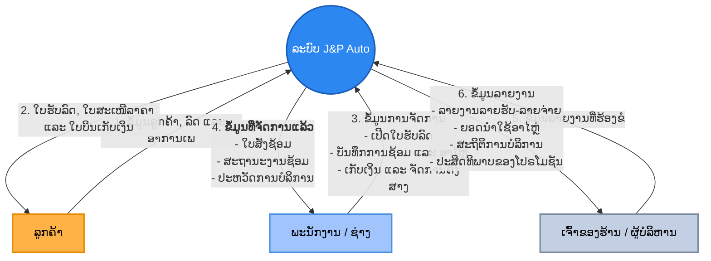
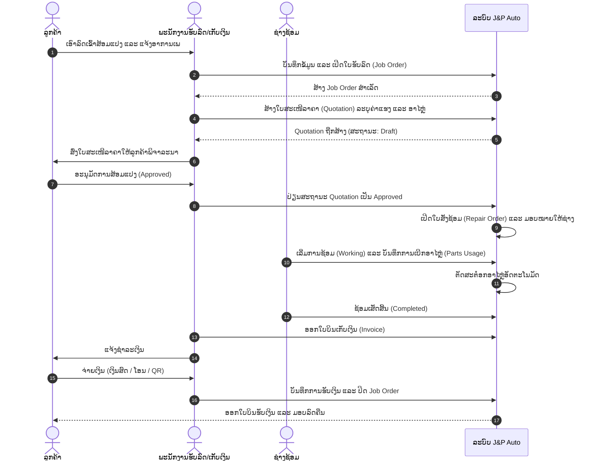

# ພາບລວມລະບົບ (System Overview) - J&P Auto Maxxing

J&P Auto Maxxing ແມ່ນລະບົບຄຸ້ມຄອງອູ່ສ້ອມແປງລົດ (Car Repair Shop Management System) ແບບຄົບວົງຈອນ ເຊິ່ງພັດທະນາຂຶ້ນມາເພື່ອຊ່ວຍອຳນວຍຄວາມສະດວກໃນການບໍລິຫານຈັດການວຽກງານພາຍໃນອູ່ສ້ອມແປງລົດ, ເລີ່ມຕັ້ງແຕ່ການຮັບລົດ, ການສະເໜີລາຄາ, ການດຳເນີນການສ້ອມແປງ, ການຄຸ້ມຄອງອາໄຫຼ່ໃນສາງ, ການອອກໃບບິນຊຳລະເງິນ ໄປຈົນເຖິງການອອກລາຍງານຕ່າງໆໃຫ້ຜູ້ບໍລິຫານ.

---

## 1. ແຜນວາດສະພາບແວດລ້ອມຂອງລະບົບ (System Context Diagram - DFD Level 0)

ແຜນວາດລຸ່ມນີ້ສະແດງເຖິງການເຊື່ອມໂຍງລະຫວ່າງ **ລະບົບ J&P Auto Maxxing (System)** ກັບຜູ້ໃຊ້ງານຫຼັກ 3 ກຸ່ມ (Actors) ຕາມໂຄງສ້າງຂອງໂຄງການ:

---

## 2. ບົດບາດຂອງຜູ້ໃຊ້ງານໃນລະບົບ (Key Actors & Roles)

ລະບົບໄດ້ແບ່ງສິດທິ ແລະ ບົດບາດຂອງຜູ້ໃຊ້ງານອອກເປັນ **3 ບົດບາດຫຼັກ** ຕາມຖານຂໍ້ມູນ (`employees.role`):

### 1. ລູກຄ້າ (Customer)
*   **ການລົງທະບຽນ**: ບັນທຶກຂໍ້ມູນສ່ວນຕົວ (ຊື່, ເບີໂທ, ທີ່ຢູ່) ແລະ ຂໍ້ມູນລົດ (ຍີ່ຫໍ້, ທະບຽນ, ເລກຖັງ).
*   **ການຮັບບໍລິການ**: ແຈ້ງອາການເພ, ຮັບໃບຮັບລົດ (Job Order).
*   **ການອະນຸມັດ ແລະ ຊຳລະ**: ກວດສອບ ແລະ ອະນຸມັດໃບສະເໜີລາຄາ (Quotation), ຮັບໃບບິນເກັບເງິນ (Invoice) ແລະ ໃບຮັບເງິນຫຼັງຊຳລະ.

### 2. ພະນັກງານ (Employee)
ພະນັກງານແບ່ງອອກເປັນ 3 ປະເພດຍ່ອຍ:
*   **ຜູ້ບໍລິຫານລະບົບ (Admin)**:
    *   ຄຸ້ມຄອງຂໍ້ມູນພື້ນຖານ: ຂໍ້ມູນຮ້ານ, ພະນັກງານ, ຜູ້ສະໜອງ (Suppliers).
    *   ຄຸ້ມຄອງສາງອາໄຫຼ່ (Parts & Stock Movement) ແລະ ການຈັດຊື້ (Purchase Orders).
    *   ກຳນົດໂປຣໂມຊັນ (Promotions) ແລະ ລາຍການບໍລິການ (Services).
*   **ຊ່າງຊ້ອມ (Mechanic)**:
    *   ຮັບໃບສັ່ງຊ້ອມ (Repair Order) ທີ່ໄດ້ຮັບອະນຸມັດແລ້ວ.
    *   ດຳເນີນການສ້ອມແປງ: ປ່ຽນສະຖານະ (ລໍຖ້າ, ກຳລັງຊ້ອມ, ຢຸດຊົ່ວຄາວ, ເສັດສິ້ນ).
    *   ບັນທຶກການນຳໃຊ້ອາໄຫຼ່ (Parts Usage) ແລະ ວັດສະດຸອຸປະກອນ.
*   **ພະນັກງານເກັບເງິນ (Cashier)**:
    *   ສ້າງໃບສະເໜີລາຄາ (Quotation) ແລະ ສົ່ງໃຫ້ລູກຄ້າອະນຸມັດ.
    *   ສ້າງໃບບິນຊຳລະເງິນ (Invoice) ເມື່ອການຊ້ອມເສັດສິ້ນ.
    *   ຮັບເງິນ ແລະ ປ່ຽນສະຖານະການຊຳລະເງິນ (ເງິນສົດ, ໂອນ, QR Code).

### 3. ເຈົ້າຂອງບໍລິສັດ / ຜູ້ບໍລິຫານ (Company Owner / Admin)
*   ຕິດຕາມພາບລວມຂອງອູ່ຜ່ານໜ້າ Dashboard (ຍອດຂາຍປະຈຳວັນ, ປະຈຳເດືອນ, ຈຳນວນລົດທີ່ກຳລັງຊ້ອມ).
*   ຮ້ອງຂໍ ແລະ ດຶງຂໍ້ມູນລາຍງານສະຖິຕິຕ່າງໆ ເພື່ອວິເຄາະທຸລະກິດ.

---

## 3. ຂັ້ນຕອນການເຮັດວຽກຫຼັກຂອງລະບົບ (Core Workflows)

---

## 4. ໂຄງສ້າງການລາຍງານຂອງຜູ້ບໍລິຫານ (Reporting Structure)

ລະບົບມີລະບົບລາຍງານທີ່ລະອຽດ ເຊິ່ງຕອບສະໜອງຄວາມຕ້ອງການຂອງເຈົ້າຂອງບໍລິສັດໂດຍກົງ:

1.  **ລາຍງານລາຍຮັບ (Revenue Report)**:
    *   ສະແດງຍອດລາຍຮັບຕົວຈິງຈາກໃບບິນ, ຄ່າໃຊ້ຈ່າຍຂອງອາໄຫຼ່ທີ່ໃຊ້, ມູນຄ່າການຈັດຊື້, ແລະ ກຳໄລສຸດທິ (Net Profit).
2.  **ລາຍງານການສ້ອມແປງ (Repair Summary Report)**:
    *   ສະແດງສະຖິຕິສະຖານະການຊ້ອມ, ໄລຍະເວລາສະເລ່ຍໃນການຊ້ອມແຕ່ລະຄັ້ງ, ຍີ່ຫໍ້ລົດທີ່ເຂົ້າໃຊ້ບໍລິການຫຼາຍທີ່ສຸດ, ແລະ ຜົນງານຂອງຊ່າງແຕ່ລະຄົນ.
3.  **ລາຍງານຍອດນຳໃຊ້ອາໄຫຼ່ (Parts Usage Report)**:
    *   ສະແດງລາຍການອາໄຫຼ່ທີ່ຖືກໃຊ້ຫຼາຍທີ່ສຸດ, ມູນຄ່າຄັງສາງຄົງເຫຼືອ, ແລະ ແຈ້ງເຕືອນອາໄຫຼ່ທີ່ຕ່ຳກວ່າເກນ (Low Stock Alerts) ເພື່ອວາງແຜນການຈັດຊື້.
4.  **ລາຍງານລາຍການບໍລິການ (Service Items Report)**:
    *   ວິເຄາະປະເພດການບໍລິການທີ່ຍອດນິຍົມ ແລະ ສ້າງລາຍຮັບໄດ້ຫຼາຍທີ່ສຸດ.
5.  **ລາຍງານການນຳໃຊ້ໂປຣໂມຊັນ (Promotion Usage Report)**:
    *   ປະເມີນປະສິດທິພາບຂອງແຄມເປນການຕະຫຼາດ, ສ່ວນຫຼຸດທີ່ມອບໃຫ້ລູກຄ້າ, ແລະ ການປຽບທຽບຍອດຂາຍລະຫວ່າງການໃຊ້ ແລະ ບໍ່ໃຊ້ໂປຣໂມຊັນ.

---

## 5. ເຕັກໂນໂລຢີທີ່ໃຊ້ພັດທະນາ (Technical Stack)

*   **ລະບົບຫຼັງບ້ານ (Backend API)**: ພັດທະນາດ້ວຍ **FastAPI (Python)** ທີ່ມີຄວາມໄວສູງ, ເຊື່ອມຕໍ່ຖານຂໍ້ມູນ MySQL ຜ່ານ PyMySQL ແລະ ມີລະບົບກວດສອບສິດການເຂົ້າເຖິງ (Authentication).
*   **ລະບົບໜ້າບ້ານ (Frontend UI)**: ພັດທະນາດ້ວຍ **Flet (Python)** ເຊິ່ງເປັນ Framework ສຳລັບສ້າງ UI ທີ່ສວຍງາມ ແລະ ທັນສະໄໝ, ຮອງຮັບການສະແດງຜົນຫຼາຍພາສາ (Lao, English, Thai) ຜ່ານໄຟລ໌ `i18n.py`.
*   **ຖານຂໍ້ມູນ (Database)**: ໃຊ້ **MySQL** (`jp_auto_db`) ທີ່ອອກແບບຕາມຫຼັກການຖານຂໍ້ມູນສໍາພັນ (Relational Database) ຢ່າງເປັນລະບົບ.
